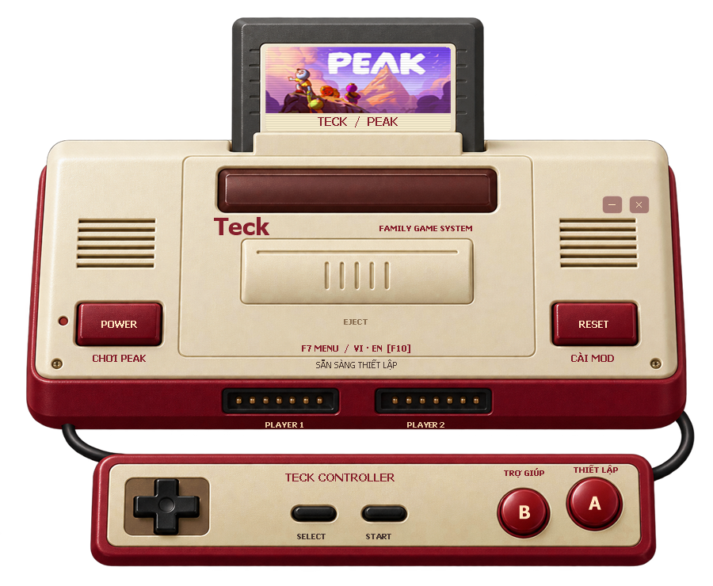

# Teck PEAK — Famicom VI / EN

Launcher PEAK cho Windows, giao diện máy chơi game Famicom cổ, vỏ nhựa đỏ kem có chất liệu và ánh sáng giống ảnh chụp, băng PEAK và tay cầm. POWER mở game, RESET cài mod, A mở thiết lập, B mở trợ giúp. Kéo thân máy để di chuyển cửa sổ. Đây là dự án cộng đồng, không liên kết với nhà phát triển PEAK.

## Sử dụng

1. Giải nén toàn bộ ZIP vào thư mục mới. Giữ Teck-PEAK.exe cạnh packages.
2. Đóng PEAK. Mở Teck-PEAK.exe → THIẾT LẬP → chọn thư mục chứa PEAK.exe.
3. Chọn bộ mod, lưu rồi bấm CÀI MOD. Dùng bản này thay launcher F7 cũ để không cài lại menu lỗi.
4. Mở Steam, đăng nhập tài khoản có PEAK. Bấm CHƠI PEAK hoặc Steam → Library → PEAK → Play.
5. Vào lobby, nhấn F7 để mở menu. F2 mở PEAK Unlimited.

Nếu Steam báo lỗi, gửi ảnh đầy đủ thông báo. Launcher chờ tối đa 30 giây để phát hiện tiến trình PEAK; thông báo phát hiện tiến trình không có nghĩa đã vào màn hình chính. Khi chưa thấy game chạy, nó hiển thị hướng dẫn và lưu nhật ký tại `%LOCALAPPDATA%\TeckPeak\launch.log`. Không chạy trực tiếp game để bỏ qua Steam.

## Các mod

| Mod | Mặc định | Công dụng |
| --- | --- | --- |
| PEAK Troll Mod 0.5.0 + Teck compat 1 | Bật | F7: đồ ăn, vật phẩm, dịch chuyển và tùy chọn nhân vật. Tiếng Việt / English, F10 đổi ngôn ngữ. |
| PEAK Unlimited 4.0.1 | Bật | Tăng giới hạn người; chủ phòng cần cài. F2 mở tùy chọn. |
| ItemInfo 0.1.7 | Bật | Thông tin vật phẩm đang cầm. |
| Start With Backpacks 1.1.0 | Bật | Bắt đầu có ba lô; chủ phòng cài. |
| Healing Campfires 4.5.1 | Tắt | Hồi phục tại lửa trại; thay đổi cân bằng. |

ModConfig riêng đã bỏ khỏi lựa chọn mặc định và được gỡ khi nâng cấp bản Teck cũ. Dùng F7 → Mod Config cho tùy chọn có sẵn của menu. Các gói phụ cũ vẫn nằm trong catalog để nhận diện và dọn file đã cài trước đó; chúng không tự được chọn.

## Bản sửa này

Menu cũ đọc CharacterData.userID dưới dạng UInt64 nhưng game hiện tại dùng String, gây MissingFieldException. Menu được biên dịch lại với thư viện của game đã cài và đọc ID bằng TryParse; thêm xử lý tắt plugin nếu khởi tạo lỗi. Phiên bản assembly là 0.5.0.1. Đây là bản sửa cộng đồng Teck, không phải phát hành chính thức của tác giả. Bản này thêm lớp dịch Teck PEAK riêng; xem LOCALIZATION-VI-EN.md.

Đã build và kiểm tra metadata API, kiểm thử cài/cập nhật/gỡ trên game giả, xuất ảnh kiểm tra giao diện. Bản sửa menu đã được áp dụng trước đó. Gói dịch mới được đóng kèm bộ cài để bạn chủ động cập nhật; chưa tự cài vào game trong lần làm này. Chưa kiểm thử các chức năng F7 trong lobby. Không cam kết đã sửa mọi trường hợp treo game.

Launcher kiểm tra SHA256 trước khi cài và có khôi phục khi lỗi ghi. Đóng game trước khi cài/gỡ. Nếu game có bộ nạp từ công cụ khác, hãy quản lý bằng công cụ đã cài. THIẾT LẬP → Gỡ mod chỉ xử lý file launcher quản lý; cấu hình mod phát sinh trong game được giữ lại.

EXE chưa ký số. Xem SECURITY-CHECK.txt, TEST-RESULTS.txt, MOD-SOURCES.md và mã nguồn trong source. Không tắt Defender hay thêm ngoại lệ khi có cảnh báo.

## Tiếng Việt / English

Mặc định Tiếng Việt. Trong game bấm F10 hoặc nút ngôn ngữ ở đầu F7 để chuyển sang English. Lựa chọn được lưu. Xem LOCALIZATION-VI-EN.md về phạm vi dịch và hướng dẫn.
